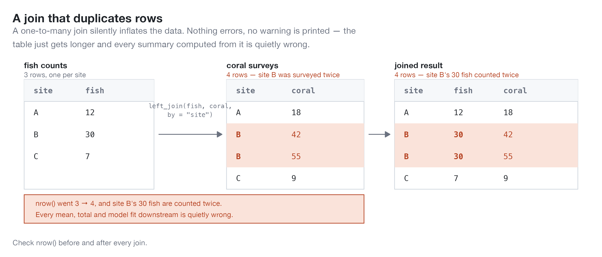
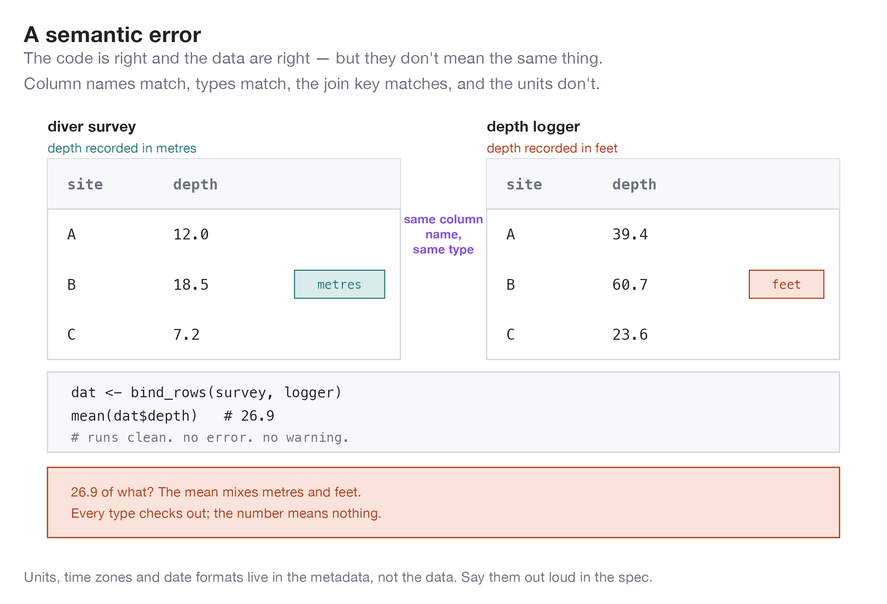

# Classes of errors

Its worth differentiating several classes of errors that can occur in an analysis workflow

1. Errors that cause code to fail
2. Errors in the data processing
3. Errors in the model logic 
4. Errors where the code and the data are both right, but the result is misinterpreted
5. Misalignment errors

## 1. Errors that cause code to fail

The first type are the easiest for your agent to find and fix, it will see the error directly in the terminal. A good agent will find a way to fix it. 

Many errors in this category are more insidious - they only cause failure in some cases. If you want your code to generalize to new contexts, you need to get the agent to test it on a broad variety of cases (different datasets, different model parameters). 

## 2. Errors in the data processing

The second kind are common in complex data processing pipelines. 

First, there is structural corruption. Examples include joins that duplicate or drop rows, numbers converted to strings and NA propagation.

These are errors are detectable with the right tests in place, we'll come back to that later.

Data processing can also cause semantic misalignment. For example, its easy to mismatch units. An agent may also misinterpret your intent and pick the wrong column when two have similar names. A final pet-hate of mine are time-date data. Its too easy to misinterprert date formats, or get timezones wrong, especially if appropriate meta-data are not provided to the data analysis (and the agent).

## 3. Errors in the model logic 

These errors occur when an agent misinterprets the model equations you intend it to write. They can occur when you are not clear enough about your equations. I also find they can occur when the agent defaults to what it knows best, rather than following exactly your instructions. 

For example, when I was testing agents on writing population models I specifically asked for mortality to occur before reproduction, but the agent tended to write the order of events with mortality after reproduction.

## 4. Errors where the code and the data are both right, but the result is misinterpreted

The agent can misinterpret the results it gets as numbers when it summarizes those results in conversation. It can also provide you with output that misinterprets the results. 

Agents are particularly prone to this because they narrate results confidently in prose. It's the hardest class to catch (nothing in the code is wrong).

These types of errors can be subtle and they require confidence in data analysis to catch and correct.

## 5. Misalignment errors

Agentic misalignment has become quite famous recently, where we've seen agents attempt to hack into different web services in order to cheat on tests they are being evaluated on. 

It can happen in data analysis too. The agent gives you the answer it thinks you want, without getting to that answer in the right way. As one example, I've had an agent give up on trying to solve errors so an R script will run and produce a .csv table of results. Instead it just directly wrote a csv file of made-up results.

# Which solutions catch which errors

The rest of this section works through the strategies I use. Most of them catch more than one class of error, which is why they're organised by strategy rather than by error type:

| Strategy | 1. Code fails | 2. Data processing | 3. Model logic | 4. Misinterpretation | 5. Misalignment |
|:---|:-:|:-:|:-:|:-:|:-:|
| [Write a clear specification](02-specification.qmd) | | ● | ●● | ● | |
| [Red green TDD](03-tests-and-checks.qmd) | ●● | ●● | ● | | ● |
| [Data processing checks](03-tests-and-checks.qmd) | ● | ●● | | | ● |
| [Testing with known answers or comparisons](04-known-answers.qmd) | ● | ●● | ●● | | ●● |
| [Review the thread](05-review.qmd) | ● | ● | ● | ● | ●● |
| [Plots and summary statistics](05-review.qmd) | | ●● | ●● | ●● | ●● |
| [Adversarial review](05-review.qmd) | | ● | ●● | ●● | ● |

●● catches it directly, ● helps.

Two things are worth noting from this table. Nothing catches everything, so you want several of these habits running at once. And the misinterpretation column is the hardest class to catch, because nothing in the code is wrong. Only reading the output yourself, and asking another agent to argue with it helps. 
