## This session's roadmap

1. **AI tools for data analysis** - Background
2. **Setup** — Positron / VS Code + Copilot
3. **Section 1** — Line-by-line completion
4. **Section 2** — Agents
5. **Afternoon** — your choice (see the end of this deck)

::: {.callout-tip}
Each activity is short — the book has full walkthroughs and a Challenge for every one.
:::

# Intro to LLMs for coding {.section-divider}

## 

## A story


## AI is replacing coding by hand

Almost everyone is using it now

> 22% of marine conservation professionals are using AI to help with data tasks. 34% want to use it

Source: octogroup.org

Serious analysts are using it even more

But is it any good? 

## Who's in the room?

Quick introductions

- Name
- Institution
- What your research is on

## How do LLMs work?

Predict one token at a time

https://www.youtube.com/watch?v=wjZofJX0v4M

(skip to 1:25)

## Simultaneously amazing...

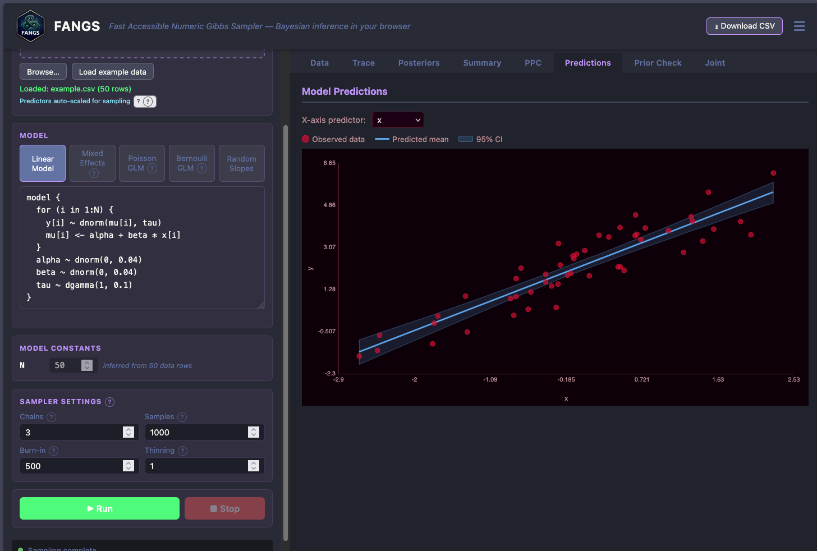

FANGS - Chris' own Bayesian modelling software that runs in your browser

## And underwhelming...

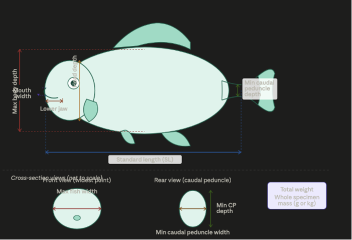

Claude 3.7 morphological diagram of a fish

## Risks to scientific integrity?

## Evaluating LLMs for coding

- Repeat the same prompt 10 times
- Score answers against a solution or rubric
- This is what software engineers do
- We can do it for data analysis too

## Code that works, but is often scientifically flawed

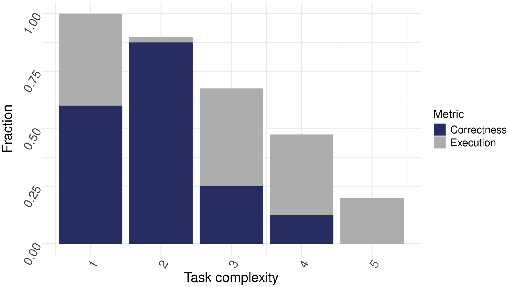

Jansen et al. 2025 "Leveraging large language models for data analysis automation”"

## Can AI agents complete an ecological analysis report?

:::: {.columns}

::: {.column width="65%"}
- Paper: "Automating Ecological and Fisheries Modelling With Agentic AI"
- Ran AI agents with different LLMs
- Repeated each prompt 10 times
- Goal was to create a full data analysis with report
- Marked to a rubric
:::

::: {.column width="35%" .qr}

:::

::::


## Results

::: {.big-figure}
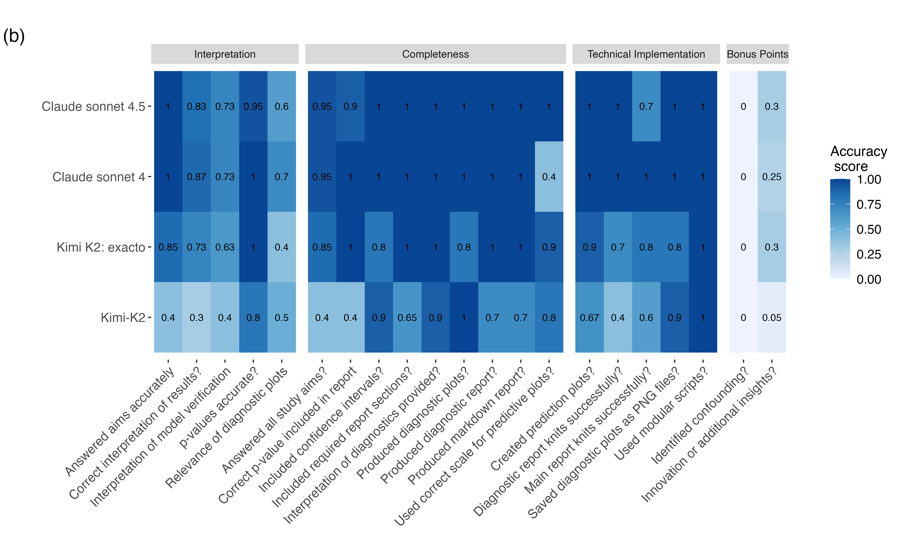
:::

::: {.paper-caption}
Brown et al. 2026 "Automating Ecological and Fisheries Modelling With Agentic AI"
:::

## Results

::: {.big-figure}
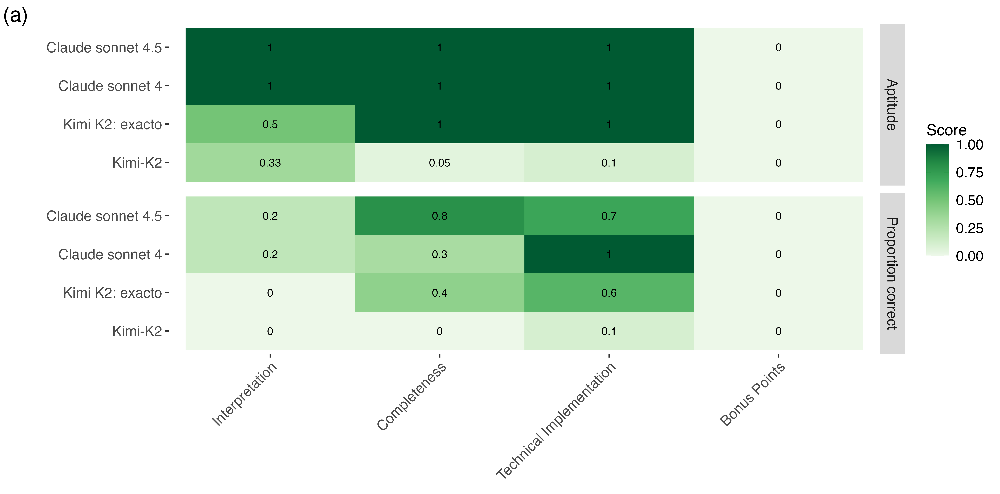
:::

::: {.paper-caption}
Brown et al. 2026 "Automating Ecological and Fisheries Modelling With Agentic AI"
:::

## How best to use AI coding tools?

:::: {.columns}

::: {.column width="65%"}
Brown and Spillias 2026 "Prompting large language models for quality ecological statistics"
:::

::: {.column width="35%" .qr}

:::

::::

## Break the problem into parts

::: {.big-figure}
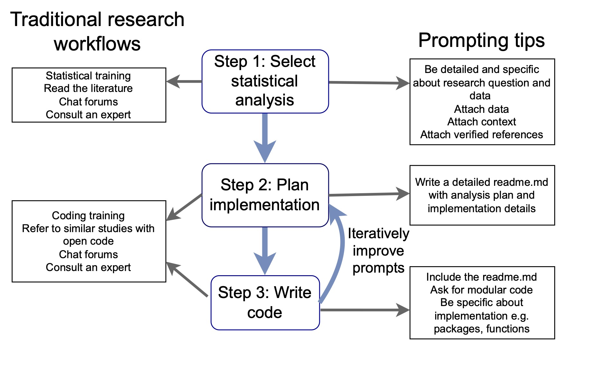
:::

::: {.paper-caption}
Brown and Spillias 2026 "Prompting large language models for quality ecological statistics"
:::

## 1. Select analysis

- Be specific 
- Give detailed context
- Attach data
- Attach verified context (e.g refs)

## 1. Select analysis

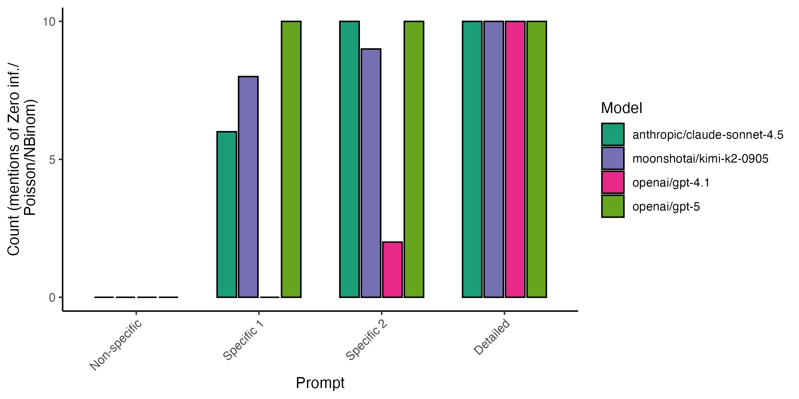

## 2. Plan implemenetation

More detailed plans give more consistent code

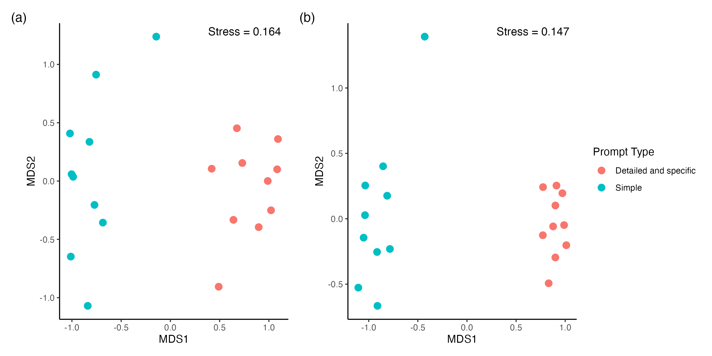

## 3. Write code 

Detailed plans = more accurate results with cheaper models. 

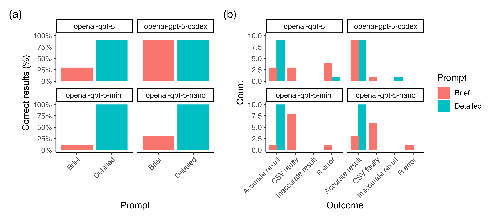

## Today's workshop 

We'll practice these skills

Also time for being flexible with learning goals

# Setup {.section-divider}

Getting your tools ready

## Set up your IDE

*Positron or VS Code, plus GitHub Copilot*

:::: {.columns}

::: {.column width="58%"}
1. Install Positron (easiest for R users) — or VS Code and its clones (Cursor, Windsurf)
2. Install the GitHub Copilot extension and sign in with your GitHub account
3. Using `ellmer` or Gander too? Get an API key — OpenRouter is the recommended default
:::

::::

Full step-by-step instructions: the book's [Setup](../02-setup.qmd) chapter.

## Activity — Find your way around

**Goal:** spend a few minutes comparing your new IDE to RStudio

- Terminal / console — where R runs
- Script editor — where you write and edit code
- Environment / variables pane — the objects in your session
- Plots or viewer pane — where figures appear
- Extensions panel — where Copilot and other tools live

::: {.callout-important title="Challenge" appearance="simple"}
Open a script, run a line of R, and find where your plot appears.
:::

## Get the data and prompts


# Section 1 {.section-divider}

Line-by-line completion with GitHub Copilot

## What is line-by-line completion?

- You type, and the assistant guesses what comes next
- Press `Tab` to accept — or keep typing to ignore it
- Best for small, targeted edits — mistakes are obvious

::: {.callout-tip}
This is the "judicious" way to use AI: targeted, low-risk, and easy to verify as you go.
:::

[Section 1 overview →](../section-1-line-by-line/index.qmd)

## Activity 1 — Inline completion

**Goal:** load the reef dataset and tab-complete a plot without typing the code yourself.

1. Load the benthic coral-cover & fish-count dataset
2. Start a new line, type `gg…` and watch the suggestion appear
3. Press `Tab` to accept, or keep typing to steer it

::: {.callout-important title="Challenge" appearance="simple"}
Plot `CB_cover` against `dist_to_logging_km` without typing any variable names first — how many attempts before it uses the right columns?
:::

::: {.notes}
~10 minutes. [Full module →](../section-1-line-by-line/01-inline-completion.qmd)
:::

## Activity 2 — Completion via comment creation

**Goal:** write what you want in a comment, and let Copilot write the code underneath it.

1. Write a one-line comment above the cursor
2. Trigger the suggestion and press `Tab`
3. Try templating a whole sequence of plots from comments alone

::: {.callout-note title="Prompt"}
```
# Make a point plot of secchi against pres.topa
```
:::

::: {.callout-important title="Challenge" appearance="simple"}
Produce a grouped summary of `secchi` and `pres.topa` by `flow` — comments only, no typed R code.
:::

::: {.notes}
~10 minutes. [Full module →](../section-1-line-by-line/02-comment-driven-completion.qmd)
:::

## Gander — an RStudio-friendly alternative

:::: {.columns}

::: {.column width="55%"}
- Stays inside RStudio — no need to switch IDE
- Sees inside your R session, so it already knows your variable names and their types
- Select code, hit your shortcut key, and type a prompt
:::

::: {.column width="45%"}
::: {.callout-note title="Live demo"}
"Make a ggplot of pres.topa against CB_cover, coloured by logged"

"Add a stat_smooth to this plot"
:::
:::

::::

::: {.notes}
Live demo, ~5 minutes. [Details →](../section-1-line-by-line/05-gander.qmd) — set-up instructions are in [Setup](../02-setup.qmd#sec-gander).
:::

## Activity 3 — Next edit suggestions

**Goal:** write one working example, then let Copilot help generalise it into a function.

1. Write the code for a single case (e.g. one species)
2. Turn on Next Edit Suggestions (the octocat icon, bottom right)
3. Start wrapping it in a function — tab through each suggested edit

::: {.callout-tip title="Why this matters"}
This is the same discipline an agent needs from you: a clear spec, worked out on one concrete case before you automate it. Next stop: Section 2.
:::

::: {.notes}
~10 minutes. [Full module →](../section-1-line-by-line/03-next-edit-suggestions.qmd)
:::

# Section 2 {.section-divider}

Agents — automate programming a whole workflow

## How agents work

Agents run tools in a loop:

1. **Prompt**
2. **Model picks a tool**
3. **Tool runs**
4. **Result feeds back**

… and repeats until the model runs its 'task complete tool' or 'user question tool'

::: {.callout-note}
By default, agents ask permission before each tool use. We'll unpack the security trade-offs properly in Section 4.
:::

[Section 2 overview →](../section-2-agents/index.qmd)

## How agents work

::: {.figure-row}
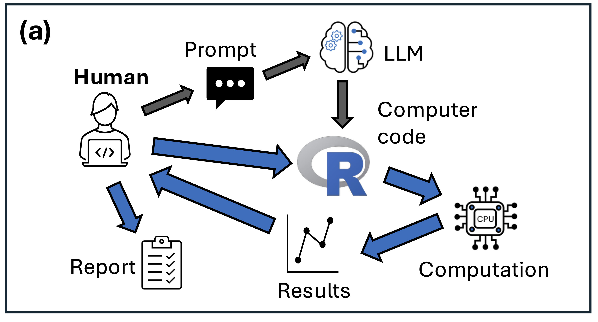
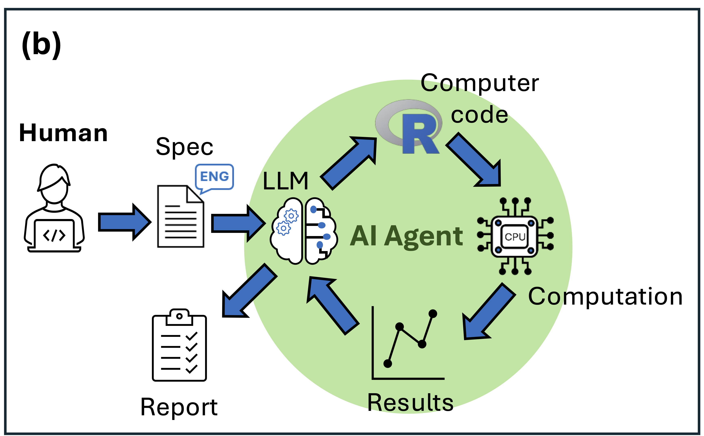
:::

::: {.paper-caption}
Brown et al. 2026 "Automating Ecological and Fisheries Modelling With Agentic AI"
:::

## Activity — Create an analysis with an agent

**Goal:** hand the agent a real regression task, end to end — scripts, run, and plots.

1. Switch your assistant to Agent mode
2. Open the data readme so the agent has variable context
3. Prompt it, then follow along — adjust or correct as it goes

::: {.callout-note title="Prompt"}
I want to do a regression of pres.topa on cb_cover. Create all the scripts I need, and run them to make plots of the predicted relationship.
:::

::: {.callout-important title="Challenge" appearance="simple"}
Run the same prompt twice, in two separate sessions — did the agent pick the same GLM family both times?
:::

::: {.notes}
~15 minutes. [Full module →](../section-2-agents/04-first-agent-example.qmd)
:::

## Prompting practice

**Goal:** keep an agent on track.

- Rich and relevant context is key
- Attach context: data summaries, metadata, domain knowledge
- Compare runs — same prompt, different agents or models

::: {.callout-tip title="From the book"}
Try: "Arrr matey, I be wantin' a regression of pres.topa on cb_cover…" 
:::

::: {.notes}
~10 minutes. [More on prompting agents →](../section-2-agents/05-prompting-agents-part1.qmd) and [part 2](../section-2-agents/06-prompting-agents-part2.qmd).
:::

## Specification practice

**Goal:** Agents do best with a detailed spec

Chris to show full spec for the benthic fish GLM. 

## Where that leaves us

:::: {.columns}

::: {.column width="33%"}
**3** completion activities

Inline, comments, and Gander
:::

::: {.column width="33%"}
**1** full agent run

A regression, end to end
:::

::: {.column width="33%"}
**2** prompting practices

Context, and content over style
:::

::::

Every activity has more detail, screenshots, and a Challenge in the book — go back any time:
[seascapemodels.org/AI-assistants-for-scientific-coding](https://www.seascapemodels.org/AI-assistants-for-scientific-coding/)

## What next?

:::: {.columns}

::: {.column width="33%"}
**[Section 3 — AI in Workflows](../section-3-workflows/index.qmd)**

Choose a statistical approach, plan it, then write the code

**[Section 4 — Security & Privacy](../section-4-security-privacy/index.qmd)**

The risks behind "approve everything," and safer defaults like Claude for Web. 
:::

::: {.column width="33%"}
**[Section 5 — Customizing Agents](../section-5-customizing-agents/index.qmd)**

Turn what you learned into a reusable skill or sub-agent

**[Section 6 — Agentic Engineering](../section-6-agentic-engineering/index.qmd)**

Testing & verification habits borrowed from software engineering
:::

::: {.column width="33%"}
**[Section 7 — LLM Access via API](../section-7-api-access/index.qmd)**

Go under the chat window — build a tiny agent yourself

**[Section 8 — Running Local Models](../section-8-local-models/index.qmd)**

Models on your own machine, no API key required
:::

::::

# Thank you {.section-divider}

:::: {.columns}

::: {.column width="65%"}
Book: [seascapemodels.org/AI-assistants-for-scientific-coding](https://www.seascapemodels.org/AI-assistants-for-scientific-coding/)

Blog: [Vita ex Machina](https://vitaexmachina.substack.com/)

Example data: [github.com/cbrown5/example-ecological-data](https://github.com/cbrown5/example-ecological-data)
:::

::: {.column width="35%" .qr}

:::

::::